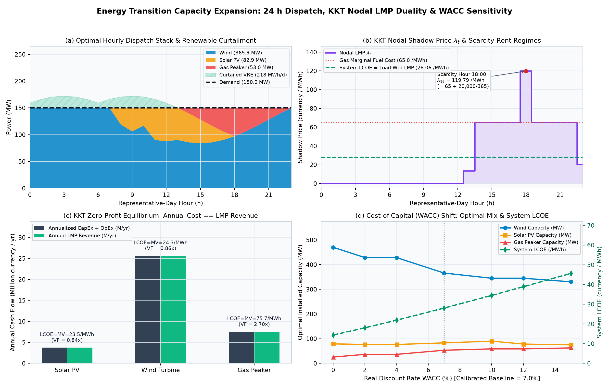
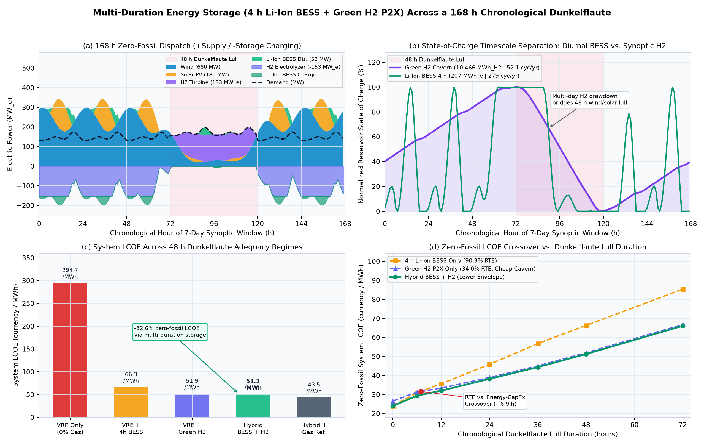
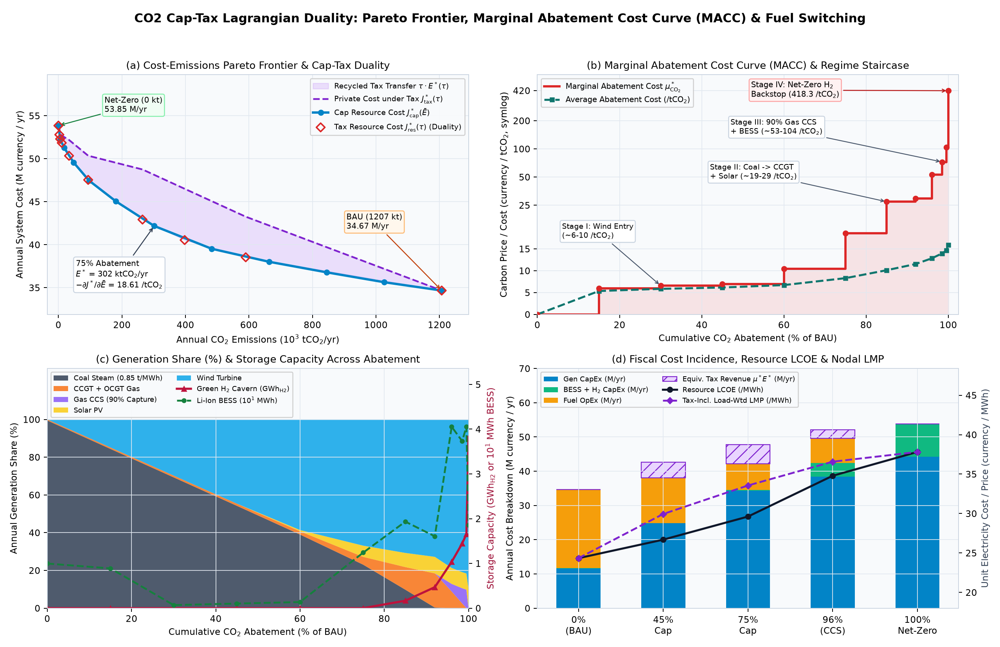
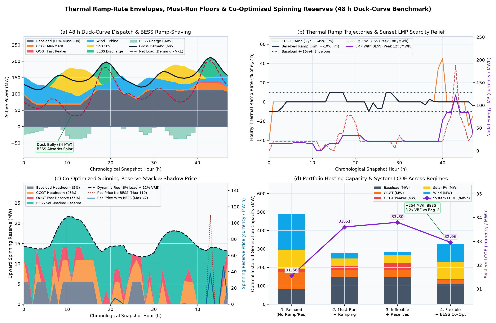
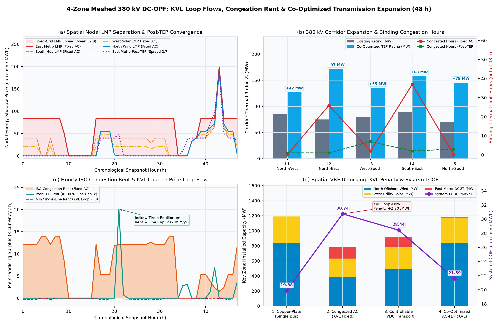
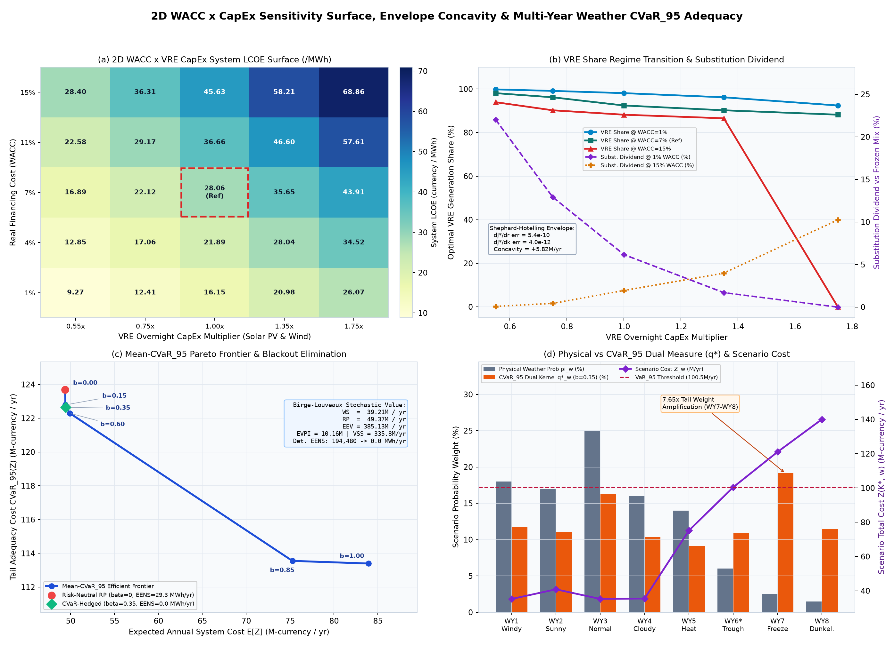
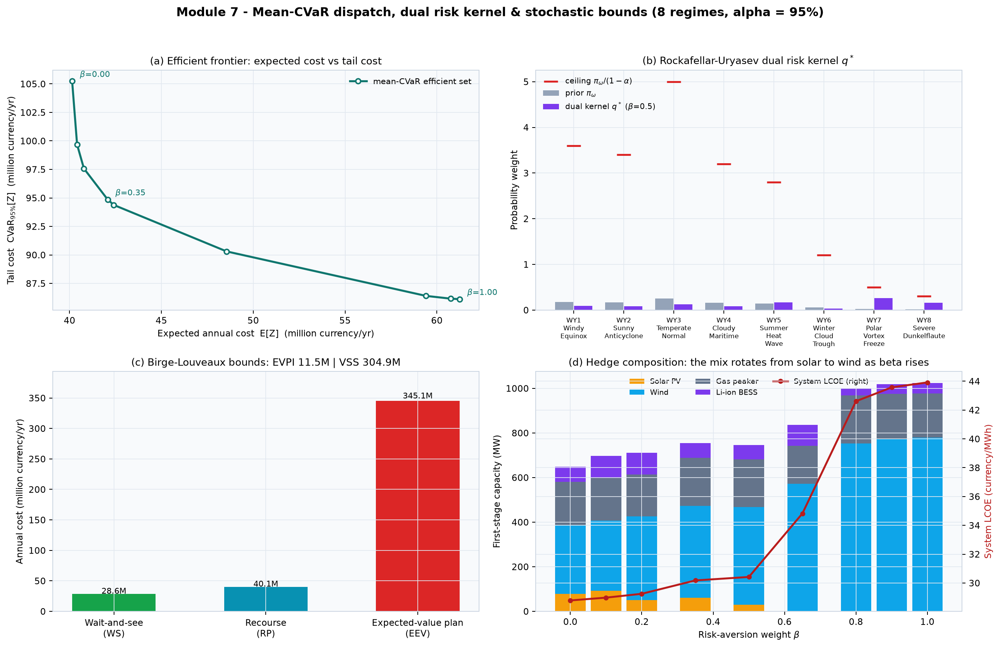

# Energy Transition Optimization Model

[](https://github.com/hariszafar740-lang/energy-transition-model/actions/workflows/ci.yml)
[](https://hariszafar740-lang.github.io/energy-transition-model/workbench/)

[](#quickstart--verification)
[](https://hariszafar740-lang.github.io/energy-transition-model/workbench/)
[](LICENSE)

**Capacity expansion, multi-duration storage and CO₂ pricing for a 100 % renewable grid — built with PyPSA and HiGHS, with every headline number cross-checked against a solver that shares no code with it.**

285 tests · Python 3.11–3.13 · MIT · no data download, no API key, no network at run time.

**[▸ Open the workbench](https://hariszafar740-lang.github.io/energy-transition-model/workbench/)** — the whole model solved and in one self-contained HTML file, offline · **[Quickstart](#quickstart--verification)** · **[Validation](#validation--six-independent-cross-checks-not-claims)**

## Validation — six independent cross-checks, not claims

| Check | This model | Independent reference | Residual | Reproduce with |
| :--- | :--- | :--- | :---: | :--- |
| LP strong duality | system LCOE = demand-weighted LMP = `28.0555` /MWh | KKT dual of the same LP | `7.45e-09` /yr | `test_kkt_strong_duality_and_zero_profit_equilibrium` |
| Nodal LMP | hourly λ_t and capacities from PyPSA/linopy | standalone sparse `scipy.optimize.linprog` (HiGHS) primal + dual | rel. objective `< 1e-10` | `test_primal_dual_crosscheck_matches_independent_scipy_linprog` |
| CO₂ cap ↔ tax | `J*_tax(μ*) = J*_cap(Ē) + μ*Ē` | Lagrangian saddle point | rel. gap `< 1e-12` | `test_tax_to_cap_primal_and_saddle_point_equivalence` |
| Meshed DC-OPF | congestion rents from PyPSA PTDF flows | cycle-KVL / B-θ OPF on the same network | rel. objective `< 1e-11` | `test_scipy_btheta_matches_pypsa_cycle_kvl_to_machine_precision` |
| Mean-CVaR plan | risk-averse objective, CVaR, first-stage capacities | independent 1,357-variable matrix LP | rel. CVaR `< 1e-11` | `test_scipy_matrix_matches_pypsa_stochastic_cvar_to_machine_precision` |
| Offline workbench | `workbench/index.html` served by Pages | committed `workbench/data/etm_workbench_data.json` | byte-identical | `etm-workbench check`, re-run by CI on every push |

Every figure further down is asserted against the code that produces it: `tests/test_workbench_and_cvar.py` fails the build if a README number drifts from the committed dataset.

## Quickstart & verification

Four commands from clone to first result. No data download, no API key, nothing to configure:

~~~bash
git clone --depth 1 https://github.com/hariszafar740-lang/energy-transition-model.git
cd energy-transition-model
python3 -m venv .venv && .venv/bin/pip install -e .
.venv/bin/etm-sim --duality-report
~~~

~~~
System LCOE (currency/MWh):                28.0555
Demand-weighted LMP (currency/MWh):        28.0555
Strong-duality gap (currency/yr):      -7.4506e-09
Max built zero-profit residual:         4.6566e-10
~~~

That is the solver's price of energy for a representative day, the demand-weighted dual price, and the gap between them — the identity asserted in the first row of the table above. Add `--dunkelflaute-report` for the 168 h storage study, `--macc-report` for the CO₂ abatement curve, `--cvar-report` for the risk-averse plan.

Full suite: `.venv/bin/pip install -e ".[dev]" && .venv/bin/pytest -v` — 285 tests, about 7 minutes.

## Deep dive

Formulations, assumptions, sensitivities and figures, module by module.

An open-source energy-system capacity-expansion, chronological multi-duration energy storage (`Li-Ion BESS` + `Green H2` Power-to-X), discounted cash-flow (`WACC` / `CRF` / `LCOE`), KKT nodal shadow-price (`LMP`) duality, CO2 cap-and-trade, ramp/reserve adequacy, meshed `DC-OPF`/`AC-TEP` and mean-CVaR stochastic model built with **PyPSA** (Python for Power System Analysis) and the **HiGHS** linear-programming solver — plus a **single-file, offline, zero-dependency interactive workbench** that renders every solved module in the browser.

[](https://hariszafar740-lang.github.io/energy-transition-model/workbench/)



## Academic Credential & Course Context

This repository serves as the practical engineering implementation for the official microcredential:
* **Course & Badge Title:** Modelling the Energy Transition: the revolution of open-source software
* **Issuing Institution:** Politecnico di Milano
* **Qualification Level:** EQF Level 7

## Architecture & Module Capabilities (`v1.0.0`)

* **Single-bus LP baseline (`energy_model/model.py`):** Representative-day capacity expansion (`Regional_Grid`, `System_Demand`, `Solar_PV`, `Wind_Turbine`, `Gas_Peaker`) with strict hourly time-series validation (`energy_model/profiles.py`).
* **Discounted cash-flow & KKT nodal price duality (`energy_model/economics.py`):**
  * Exact Capital Recovery Factor $\text{CRF}(r, N)$ annualisation across real discount rates (`WACC` $r \in [0, 1]$).
  * Extraction of hourly KKT power-balance dual multipliers $\lambda_t$ (`LMP`), verification of **LP Strong Duality** ($\text{System LCOE} = \bar{\lambda}_{\text{load}}^* = 28.0555\text{ /MWh}$), **Boiteux-Turvey-Stoft Zero-Profit Equilibrium**, and **Brown-Hirth Market-Value Parity** ($\text{LCOE}_g = \text{MV}_g$).
* **Multi-duration storage & `Dunkelflaute` chronological adequacy (`energy_model/storage.py`):**
  * **Short-duration power-coupled battery (`Li_Ion_BESS` via PyPSA `StorageUnit`):** `4 h` duration, $\eta_{\text{ch}} = \eta_{\text{dis}} = 95\%$ ($\eta_{\text{RTE}} = 90.25\%$), cyclic State-of-Charge (`SoC`), optimal for daily midday-solar-to-evening shifting (`278.7` eq. cycles/yr).
  * **Long-duration decoupled Power-to-X hydrogen (`Green_H2` via PyPSA `Bus` + `Store` + `Link`s):** Independently sized `H2_Electrolyzer` ($\eta_{\text{el}} = 68\%$), underground `H2_Cavern` (`350` currency/MWh$_{\text{H2}}$/yr, cyclic `SoC`), and `H2_Turbine` ($\eta_{\text{fc}} = 50\%$, $\eta_{\text{RTE}} = 34.0\%$), optimal for bridging multi-day **`Dunkelflaute`** wind/solar lulls (`52.1` eq. cycles/yr).
  * **Independent matrix LP cross-checks:** Both `economics.py` and `storage.py` construct standalone `scipy.optimize.linprog(..., method="highs")` primal + dual matrices confirming `< 1e-11` agreement with PyPSA/linopy across capacities, objective values, and nodal shadow prices.
* **CO2 cap–tax Lagrangian duality & MACC (`energy_model/emissions.py`):** Partial-equilibrium multi-fuel emissions accounting, annual `CO2` caps, Pigouvian taxes, and the saddle-point identity $J_{\text{tax}}^*(\mu^*) = J_{\text{cap}}^*(\bar{E}) + \mu^* \bar{E}$ to `2.2e-08` currency/yr.
* **Operational flexibility (`energy_model/flexibility.py`):** Intertemporal ramp envelopes, must-run floors, co-optimised upward spinning reserves, and a proof that binding ramps can produce strictly negative nodal prices with non-negative fuel costs (`-138.00` currency/MWh).
* **Meshed transmission (`energy_model/transmission.py`):** 4-zone / 5-corridor `DC-OPF` with `PTDF`/`KVL` equivalence, ISO merchandising surplus, `AC-TEP` co-optimisation, and a Wheatstone-bridge Braess paradox (`+62.5%` dispatch cost for a zero-cost passive line).
* **Risk-aware planning (`energy_model/workbench.py`):** An explicit 1,357-variable mean-CVaR linear program over 8 weather-and-demand regimes with a Rockafellar–Uryasev epigraph, dual risk kernel $q^*$, and Birge–Louveaux bounds (`WS ≤ RP ≤ EEV`).
* **Offline workbench (`workbench/`):** `etm-workbench build` re-solves every module, writes `workbench/data/etm_workbench_data.json`, and renders a single self-contained `workbench/index.html` (no CDN, no fonts, no network requests) that CI re-verifies byte-for-byte on every push.

## Multi-Duration Storage & `Dunkelflaute` Adequacy (`v0.4.0`)



### Coupled AC + Hydrogen Intertemporal Formulation

Over a chronological horizon $t \in \{0,\dots,T-1\}$ ($T = 168\text{ h}$, annual weight $w = 8760 / T$):

$$\sum_{g \in \mathcal{G}} p_{g,t} + p_{\text{bess,dis},t} - p_{\text{bess,ch},t} + p_{\text{H2,dis},t}^{\text{elec}} - p_{\text{H2,ch},t}^{\text{elec}} = d_t \qquad [\text{dual } w \lambda_t^{\text{elec}}]$$

$$e_{\text{bess},t} = (1 - \sigma_{\text{bess}}) e_{\text{bess},(t-1)\bmod T} + \eta_{\text{ch}} p_{\text{bess,ch},t} \Delta t - \frac{1}{\eta_{\text{dis}}} p_{\text{bess,dis},t} \Delta t, \quad 0 \le e_{\text{bess},t} \le \tau_{\text{bess}} P_{\text{bess}}$$

$$e_{\text{H2},t} = (1 - \sigma_{\text{H2}}) e_{\text{H2},(t-1)\bmod T} + \eta_{\text{el}} p_{\text{H2,ch},t}^{\text{elec}} \Delta t - \frac{1}{\eta_{\text{fc}}} p_{\text{H2,dis},t}^{\text{elec}} \Delta t, \quad 0 \le e_{\text{H2},t} \le E_{\text{H2}} \quad [\text{dual } w \lambda_t^{\text{H2}}]$$

### Verified 168-Hour `Dunkelflaute` Adequacy Regimes (`48 h` Cold Wind/Solar Lull)

| Adequacy Regime | `Solar_PV` | `Wind_Turbine` | `Li_Ion_BESS` (`4 h`) | `H2` Electrolyzer / Turbine | `H2_Cavern` Store | System `LCOE` |
| :--- | :---: | :---: | :---: | :---: | :---: | :---: |
| **1. VRE Only (`0%` Gas)** | `0.0 MW` | `5,657.3 MW` | `—` | `—` | `—` | `294.70` / MWh |
| **2. VRE + `4 h` BESS (`0%` Gas)** | `0.0 MW` | `599.5 MW` | `1,570.0 MW` (`6,280 MWh`) | `—` | `—` | `66.28` / MWh |
| **3. VRE + Green `H2` (`0%` Gas)** | `148.1 MW` | `707.9 MW` | `—` | `176.3` / `173.2 MW_e` | `10,745 MWh_H2` | `51.92` / MWh |
| **4. Hybrid `BESS + H2` (`0%` Gas)** | `180.2 MW` | `679.6 MW` | `51.8 MW` (`207 MWh`) | `153.3` / `132.8 MW_e` | `10,466 MWh_H2` | **`51.25` / MWh** |
| **5. Hybrid + Uncapped Gas Ref.** | `72.2 MW` | `375.8 MW` | `58.5 MW` (`234 MWh`) | `5.1` / `1.5 MW_e` | `215 MWh_H2` | `43.49` / MWh |

* **Efficiency vs. Energy-CapEx Crossover (`~6.9 h`):** For short lulls (`0–6 h`), `Li-Ion BESS` (`90.25%` RTE) achieves lower zero-fossil `LCOE` than `Green H2` (`24.01` vs. `26.53` / MWh at `0 h`). Beyond `~6.9 h` (`12–72 h` `Dunkelflaute`), decoupled `H2` cavern storage (`350` / MWh$_{\text{H2}}$ / yr) decisively beats `4 h` battery packs (`66.76` vs. `85.31` / MWh at `72 h`), while the **Hybrid `BESS + H2` portfolio forms the Pareto-optimal lower envelope across every duration**.

## CO2 Cap-Tax Lagrangian Duality & Marginal Abatement Cost Curve (v0.5.0)

Module 3 (`energy_model/emissions.py`) extends the single-bus capacity-expansion engine with primary-to-electric multi-fuel emissions accounting ($e_g = \text{EF}_{\text{th},c(g)} / \eta_g$), PyPSA `GlobalConstraint` annual $\text{CO}_2$ caps ($\bar{E}_{\text{CO2}}$), Pigouvian carbon taxes ($\tau$), and an independent sparse `scipy.optimize.linprog` (`HiGHS`) primal/dual cross-check:

1. **Lagrangian Cap-Tax Saddle-Point Equivalence:** Relaxing $\sum_{g,t} w_t e_g p_{g,t} \Delta t \le \bar{E}$ with KKT shadow carbon price $\mu_{\text{CO2}}^* = -\partial J_{\text{cap}}^*(\bar{E})/\partial \bar{E} \ge 0$ yields the exact Pigouvian carbon-tax objective identity across every point on the convex Pareto frontier:
   $$J_{\text{tax}}^*(\mu_{\text{CO2}}^*) = J_{\text{cap}}^*(\bar{E}) + \mu_{\text{CO2}}^* \cdot \bar{E}$$
   verified numerically to relative saddle-point residual $\le 1.6 \times 10^{-15}$.
2. **Net-Zero Boundary Subdifferential Regularisation ($\bar{E} = 0$):** Because the dual objective $\max b^\top y - \bar{E}\mu$ assigns zero weight to $\mu$ at $\bar{E} = 0$, the subdifferential $-\partial J_{\text{cap}}^*(0)$ is the half-ray $[\tau_{\min}^{\text{net-zero}}, +\infty)$. Evaluating the right-hand limit $\lim_{\epsilon \downarrow 0^+} \mu^*(\epsilon)$ uniquely extracts the minimum Net-Zero carbon price (`418.25` currency / $\text{tCO}_2$).



### Verified Multi-Fuel Decarbonization Milestones (`168 h` Representative Week, Annualised)

| Abatement Target | Realised $\text{CO}_2$ (`tCO2/yr`) | Shadow Price $\mu_{\text{CO2}}^*$ (`/tCO2`) | Average Cost (`/tCO2`) | Resource `LCOE` (`/MWh`) | Dominant Portfolio Regime |
| :---: | :---: | :---: | :---: | :---: | :--- |
| `0%` (BAU) | `1,206,958` | `0.00` | `0.00` | `24.34` | `Coal_Steam` (`181.8 MW`) + `CCGT_Gas` (`7.5 MW`) |
| `45%` Cap | `663,827` | `6.99` | `6.15` | `26.69` | Stage I: `Wind_Turbine` (`220.0 MW`) + `OCGT` |
| `75%` Cap | `301,740` | `18.61` | `8.30` | `29.61` | Stage II: `Coal -> CCGT` (`36.2 MW`) + `Solar_PV` (`61.6 MW`) |
| `96%` Cap | `48,278` | `52.77` | `12.84` | `34.79` | Stage III: `90% Gas_CCS` (`14.5 MW`) + `LiIon_BESS` (`40.5 MWh`) |
| `100%` Net-Zero | `0` | `418.25` | `15.89` | `37.81` | Stage IV: `Solar` + `Wind` + `Green H2` (`3,851.9 MWh_H2`) |

```bash
# Run multi-fuel CO2 Pareto frontier & MACC report + 4-panel figure
.venv/bin/python main.py --macc-report --save-macc-plot results/co2_pareto_frontier_and_macc.png

# Apply an explicit Pigouvian carbon tax or annual CO2 cap on the baseline 24 h scenario
.venv/bin/python main.py --co2-price 50 --co2-cap 20000
```

## Thermal Ramp-Rate Envelopes, Must-Run Floors & Spinning Reserves (v0.6.0)

Module 4 (`energy_model/flexibility.py`) introduces intertemporal thermal ramp-rate envelopes ($-r^{\text{dn}}_g K_g \le p_{g,t} - p_{g,t-1} \le r^{\text{up}}_g K_g$), minimum stable `must-run` loading ($p_{g,t} \ge p^{\min,\text{pu}}_g K_g$), co-optimized upward spinning operating reserves ($R^{\text{req}}_t = \alpha_{\text{load}} L_t + \alpha_{\text{vre}} P_{\text{VRE},t}$) coupled to battery state-of-charge (`SoC`) sustainment, and a direct sparse `scipy.optimize.linprog` (`HiGHS`) primal/dual cross-check:

1. **Co-Optimized Energy + Ancillary-Services Revenue Adequacy (Strong LP Duality):** Across all greenfield regimes with homogeneous operational, ramping, must-run, and cyclic `SoC` constraints, total annualised capital + fuel cost equals nodal energy market revenue plus exogenous load-reserve market revenue to machine precision ($\le 7.5 \times 10^{-9}$):
   $$\text{LCOE}_{\text{sys}} = \overline{\lambda}_{\text{load-wtd}} + \alpha_{\text{load}} \cdot \overline{\mu}^{\text{res}}_{\text{load-wtd}}$$
2. **Intertemporal Ramp-Induced Negative Nodal `LMP` Theorem (Zero Subsidies):** Even when every generator has strictly non-negative fuel cost ($c_g \ge 0$), binding downward and upward ramp limits across a deep midday net-load trough telescope multi-period fuel substitutions into an exact negative nodal shadow price ($\lambda_{t_0} = -138.00$ currency/MWh at $\min_g c_g = 0$).



### Verified 48 h Duck-Curve Operational Flexibility Regimes (Annualised)

| Regime | System `LCOE` (`/MWh`) | Peak `LMP` (`/MWh`) | Peak Reserve Price (`/MW-h`) | `VRE` Capacity (`MW`) | `OCGT` Peaker (`MW`) | `LiIon_BESS` (`MWh`) | Strong Duality Gap |
| :--- | :---: | :---: | :---: | :---: | :---: | :---: | :---: |
| `1_Relaxed_NoReserves` | `31.56` | `187.59` | `0.00` | `298.58` | `17.05` | `0.0` | `0.00e+00` |
| `2_MustRun_And_Ramping` | `33.61` | `187.59` | `0.00` | `67.32` | `24.96` | `0.0` | `0.00e+00` |
| `3_Inflexible_With_Reserves` | `33.80` | `187.59` | `109.59` | `59.70` | `36.46` | `0.0` | `7.45e-09` |
| `4_Flexible_BESS_CoOptimized` | `32.96` | `122.87` | `46.52` | `188.92` | `5.87` | `254.3` | `7.45e-09` |

```bash
# Run 48 h Duck-Curve flexibility & spinning-reserve comparison + 4-panel figure
.venv/bin/python main.py --flexibility-report --save-flexibility-plot results/duck_curve_ramping_and_reserves.png

# Evaluate explicit thermal ramp, must-run & spinning-reserve constraints on baseline 24 h profiles
.venv/bin/python main.py --ramp-limit 0.35 --must-run 0.25 --reserve-margin 0.08
```

## 4-Zone Meshed DC-OPF, KVL Loop Flows & Transmission Expansion (v0.7.0)

Module 5 (`energy_model/transmission.py`) models a 4-zone, 5-corridor 380 kV meshed AC transmission grid (`North_Wind`, `West_Solar`, `South_Hub`, `East_Metro` with two fundamental Kirchhoff Voltage Law cycles), analytical `PTDF` matrices, ISO Merchandising Surplus (congestion rent), co-optimized Transmission Expansion Planning (`AC-TEP`), and an independent sparse `scipy.optimize.linprog` (`HiGHS`) nodal phase-angle $B\theta$ cross-check:

1. **Cycle-Basis `KVL` vs. Nodal Voltage-Angle $B\theta$ / `PTDF` Duality:** Passive AC flows satisfy $f_{\ell,t} = b_\ell(\theta_{i,t} - \theta_{j,t}) = [\mathbf{\Phi}(\mathbf{g}_t - \mathbf{d}_t)]_\ell$ and nodal `LMP` decomposition $\boldsymbol{\lambda}_t = \lambda_{\text{ref},t}\mathbf{1} - \mathbf{\Phi}^\top(\boldsymbol{\mu}^+_t - \boldsymbol{\mu}^-_t)$ to $\le 1.5 \times 10^{-13}$.
2. **Triple Merchandising Surplus & Joskow–Tirole Cost Recovery:** ISO congestion rent satisfies $\sum_z \lambda_{z,t}(d_{z,t} - g_{z,t}) = \sum_{\ell=(i\to j)}(\lambda_{j,t} - \lambda_{i,t})f_{\ell,t} = \sum_\ell F^*_\ell(\mu^+_{\ell,t} + \mu^-_{\ell,t}) \ge 0$ at every hour, and recovers `100.00%` of optimal `AC-TEP` annualised line `CapEx` (`7,088,134` currency/yr, gap `0.00e+00`).
3. **Wheatstone-Bridge Braess's Paradox in Passive AC `DC-OPF`:** Adding a zero-cost `500 MW` passive AC bridge across a symmetric congested network reduces cheap power transfer (`120.0 -> 82.5 MW`) and raises dispatch cost by **`+62.50%`** (`4,800 -> 7,800` currency/h) via `KVL` loop binding, whereas a controllable `HVDC` link unlocks `160.0 MW` and cuts cost by **`-66.67%`** (`1,600` currency/h).



### Verified 4-Zone 380 kV Transmission & `AC-TEP` Regimes (48 h Annualised)

| Regime | System `LCOE` (`/MWh`) | Mean `LMP` Spread (`/MWh`) | `North_Wind` (`MW`) | `East_OCGT` (`MW`) | Total Grid (`MW`) | Congestion Rent (`/yr`) |
| :--- | :---: | :---: | :---: | :---: | :---: | :---: |
| `1_CopperPlate_SingleBus` | `19.88` | `0.00` | `836.91` | `0.00` | `0.0` | `0` |
| `2_Congested_AC_KVL_FixedGrid` | `30.74` | `52.90` | `385.51` | `154.47` | `400.0` | `67,585,265` |
| `3_Controllable_HVDC_Transport` | `28.44` | `50.90` | `489.75` | `131.40` | `400.0` | `81,148,386` |
| `4_CoOptimized_AC_TEP` | `21.59` | `2.70` | `835.53` | `7.98` | `737.1` | `7,088,134` |

```bash
# Run 4-zone DC-OPF, HVDC & co-optimized AC-TEP comparison + 4-panel figure
.venv/bin/python main.py --transmission-report --save-transmission-plot results/zonal_dcopf_congestion_and_tep.png

# Evaluate co-optimized 4-zone AC transmission expansion or corridor scaling
.venv/bin/python main.py --cooptimize-tep
.venv/bin/python main.py --grid-scale 1.5
```

## 2D WACC x CapEx Sensitivity Surface & Weather CVaR_95 Adequacy (v0.8.0)

Module 6 (`energy_model/risk_sensitivity.py` + `energy_model/cli.py`) unifies parametric 2D financing/learning-curve sensitivity analysis with two-stage multi-weather-year Rockafellar-Uryasev `CVaR_95` stochastic resource adequacy and ships the packaged `etm-sim` console entry point:

1. **Hotelling-Shephard Envelope Theorem & Global Cost Concavity:** Across real discount rates $r \in [1\%, 15\%]$ and VRE overnight `CapEx` multipliers $\kappa \in [0.55\times, 1.75\times]$, optimal greenfield cost $J^*(r, \kappa)$ is globally concave in annualised capital costs (midpoint concavity surplus `+5.82M` currency/yr; portfolio substitution dividend up to **`+22.02%`** vs. a frozen reference mix) and satisfies exact analytical partial derivatives $\partial J^*/\partial r = \sum_g K_g^* \kappa_g I_{0,g} \text{CRF}'(r, N_g)$ to $\le 5.4 \times 10^{-10}$.
2. **Rockafellar-Uryasev Two-Stage Stochastic `Mean-CVaR_95` & Risk-Adjusted Complete-Market Duality:** Across an 8-regime meteorological ensemble (`WY1_Windy_Equinox` $\to$ `WY8_Severe_Dunkelflaute`, $V_{\text{VoLL}} = 1{,}800$ /MWh), KKT epigraph multipliers $\rho_\omega^*$ induce an exact risk-adjusted probability measure $q_\omega^* = (1-\beta)\pi_\omega + \rho_\omega^*$ ($\sum_\omega q_\omega^* = 1$, amplifying tail `Dunkelflaute` weights by **`7.65x`** at $\beta = 0.35$) under which Strong LP Duality and 4-technology zero-profit revenue adequacy hold to $\le 1.5 \times 10^{-8}$, cross-checked against an independent sparse `scipy.optimize.linprog` (`HiGHS`) matrix to $\le 1.5 \times 10^{-15}$.
3. **Birge-Louveaux Stochastic Value Sandwich & Tail Blackout Elimination:** Deterministic mean-weather planning suffers **`194,479.6 MWh/yr`** out-of-sample `EENS` (`EEV = 385.13M` /yr vs. `RP = 49.37M` /yr, `VSS = 335.76M` /yr; `WS = 39.21M` /yr, `EVPI = 10.16M` /yr). Risk-neutral `RP` ($\beta = 0$) leaves `29.3 MWh/yr` residual Stoft scarcity shedding in `WY8`, whereas modest `CVaR_95` hedging ($\beta = 0.15$) eliminates **`100%` of load shedding (`0.0 MWh/yr`)** for **`+0.09%`** expected `LCOE` (`36.39 -> 36.42` /MWh).



### Verified Multi-Year Weather `Mean-CVaR_95` Risk Frontier (`VoLL = 1,800` /MWh)

| Risk Weight $\beta$ | Expected Cost `E[Z]` (`/yr`) | Tail `CVaR_95` (`/yr`) | `E[LCOE]` (`/MWh`) | `EENS` (`MWh/yr`) | `Solar_PV` (`MW`) | `Wind` (`MW`) | `Li_Ion_BESS` (`MW`) | `Gas_Peaker` (`MW`) |
| :---: | :---: | :---: | :---: | :---: | :---: | :---: | :---: | :---: |
| `0.00` (`RP`) | `49,367,339` | `123,698,409` | `36.39` | `29.3` | `144.9` | `320.9` | `75.8` | `184.4` |
| `0.15` | `49,409,902` | `122,790,530` | `36.42` | `0.0` | `149.4` | `318.9` | `81.1` | `184.5` |
| `0.35` (Hedged) | `49,452,092` | `122,643,766` | `36.45` | `0.0` | `159.5` | `313.1` | `81.6` | `184.1` |
| `0.60` | `49,925,568` | `122,289,968` | `36.80` | `0.0` | `192.5` | `299.8` | `81.9` | `184.1` |
| `1.00` (`CVaR`) | `83,937,794` | `113,396,667` | `61.87` | `0.0` | `491.7` | `0.0` | `0.0` | `273.0` |

```bash
# Run packaged etm-sim CLI: 2D WACC x CapEx surface + CVaR_95 frontier + 4-panel figure
.venv/bin/etm-sim --sensitivity-report --cvar-report \
  --save-risk-plot results/wacc_capex_surface_and_cvar_adequacy.png

# Evaluate custom financing/CapEx scenario + stochastic CVaR run + JSON telemetry export
.venv/bin/etm-sim --wacc 0.04 --vre-capex-scale 0.75 --cvar-beta 0.35 --json-summary /tmp/etm_summary.json
```

## Interactive Energy-Transition Workbench (v1.0.0)

Module 7 turns the model family into an **artifact you can open**: a single ~170 kB HTML file with no CDN, no web fonts, no `<script src>`, no `fetch()`, and no build step required to read it. Open `workbench/index.html` from a local clone (or the live Pages deployment) and every panel — dispatch, storage, carbon, reserves, meshed grid and risk — is driven by numbers that were produced by solving the linear programs in this repository.

**[▶ Open the live workbench](https://hariszafar740-lang.github.io/energy-transition-model/workbench/)** · `workbench/index.html` · `workbench/data/etm_workbench_data.json`

### Build → render → verify contract

```
solved models  ──►  workbench/data/etm_workbench_data.json  ──►  workbench/index.html
   (PyPSA/HiGHS)          (single source of truth)                 (single-file UI)
```

* `etm-workbench build` re-solves all six model families (**149 optimisations** — 118 PyPSA/linopy solves + 31 explicit mean-CVaR LPs, ≈120 s), embeds the results as a JSON dataset with an `etm-workbench/1` schema, and renders the page.
* `etm-workbench render` re-renders the page from the committed dataset only (≈2 s, no solver).
* `etm-workbench check` re-renders in memory and compares byte-for-byte with the committed file; **CI fails on any drift**, so a hand-edited figure cannot survive a push.
* Every page embeds `sha256` of its dataset in `<meta name="etm-data-digest">`; the footer prints the same digest, so a downloaded page can be traced back to the exact dataset that produced it.

### The page itself

| View | What it shows | Interaction |
| :--- | :--- | :--- |
| `00` Overview | 5×5 exact `LCOE` surface, module map, cross-module invariant table | click any cell → loads that case |
| `01` Dispatch & LCOE | stacked hourly dispatch, annual cost stack, nodal price | `WACC` and VRE-CapEx sliders (bilinear interpolation between 25 solved nodes) |
| `02` Storage & lulls | `BESS`-only / `H₂`-only / hybrid `LCOE` vs. lull length, 168 h SoC and dispatch | lull-duration scrubber |
| `03` Carbon & MACC | Pareto frontier, dual carbon price, step `MACC`, fuel-switching mix | abatement-target scrubber |
| `04` Flexibility | net load vs. nodal price, reserve requirement vs. reserve price | 4-regime switch |
| `05` Meshed grid | live 4-zone network diagram, corridor flows, zonal `LMP`, `PTDF` matrix | 4-regime switch + hour slider |
| `07` Risk & CVaR | mean–CVaR frontier, dual risk kernel $q^*$, Birge–Louveaux bounds | $\beta$ scrubber |
| `99` Method & checks | surrogate holdout parity, build provenance, test inventory, explicit limits | — |

Keyboard: `1…8` switch views, `[` / `]` step through them. Each view has a deep-link hash (`#/risk?beta=5`), CSV export of its table, SVG export of its active chart, and a light/dark theme toggle. The page works offline, from `file://`, in print, and under `prefers-reduced-motion`.

### Module 7a — explicit mean-CVaR stochastic program

Eight weather-and-demand regimes $\omega$ (windy equinox → severe `Dunkelflaute`, $\pi_\omega$ summing to `1.000`) are solved **jointly** as one linear program in 1,357 variables and 1,352 constraints, built as explicit sparse matrices:

$$\min_{K,\,p,\,\eta,\,z}\;(1-\beta)\sum_\omega \pi_\omega Z_\omega \;+\; \beta\Big[\eta + \frac{1}{1-\alpha}\sum_\omega \pi_\omega z_\omega\Big] \quad\text{s.t.}\quad Z_\omega \le \eta + z_\omega,\; z_\omega \ge 0$$

where $Z_\omega$ is the annual cost of future $\omega$ (annualised CapEx + gas fuel + `VoLL` × unserved energy, `1,800` currency/MWh), $K$ is the shared first-stage capacity vector, and $p_\omega$ is the hourly recourse dispatch with cyclic battery state of charge. The epigraph is the Rockafellar–Uryasev representation of $\mathrm{CVaR}_\alpha$, so $\eta^* = \mathrm{VaR}_\alpha$ and the duals of the epigraph rows **are** the risk kernel $q^*$.



#### Verified risk/return frontier ($\alpha = 95\%$, annualised, cost in `currency/yr`)

| $\beta$ | $\mathbb{E}[Z]$ (M) | $\mathrm{CVaR}_{95}$ (M) | System `LCOE` | Risk premium | Tail reduction | `EENS` (MWh/yr) | `Solar` | `Wind` | `Gas` | `BESS` |
| :---: | :---: | :---: | :---: | :---: | :---: | :---: | :---: | :---: | :---: | :---: |
| `0.00` | `40.14` | `105.24` | `28.79` / MWh | `+0.00` | `0.0%` | `167.5` | `79 MW` | `309 MW` | `192 MW` | `69 MW` |
| `0.10` | `40.41` | `99.67` | `28.98` / MWh | `+0.19` | `5.3%` | `0.0` | `91 MW` | `315 MW` | `192 MW` | `99 MW` |
| `0.20` | `40.78` | `97.57` | `29.25` / MWh | `+0.46` | `7.3%` | `0.0` | `51 MW` | `374 MW` | `189 MW` | `97 MW` |
| `0.35` | `42.08` | `94.86` | `30.18` / MWh | `+1.39` | `9.9%` | `0.0` | `61 MW` | `413 MW` | `215 MW` | `67 MW` |
| `0.50` | `42.41` | `94.38` | `30.42` / MWh | `+1.63` | `10.3%` | `0.0` | `30 MW` | `437 MW` | `215 MW` | `65 MW` |
| `0.65` | `48.55` | `90.31` | `34.82` / MWh | `+6.03` | `14.2%` | `0.0` | `0 MW` | `571 MW` | `172 MW` | `94 MW` |
| `0.80` | `59.41` | `86.40` | `42.61` / MWh | `+13.82` | `17.9%` | `0.0` | `0 MW` | `752 MW` | `216 MW` | `32 MW` |
| `0.90` | `60.75` | `86.17` | `43.57` / MWh | `+14.78` | `18.1%` | `0.0` | `0 MW` | `772 MW` | `203 MW` | `43 MW` |
| `1.00` | `61.23` | `86.12` | `43.92` / MWh | `+15.13` | `18.2%` | `0.0` | `0 MW` | `779 MW` | `198 MW` | `47 MW` |

Reading the frontier: **`1.39` currency/MWh of insurance buys `9.9%` off the worst-5% tail and eliminates every expected blackout hour** ($\beta = 0.35$); beyond $\beta \approx 0.65$ the hedge rotates out of solar entirely into wind plus storage, and the marginal price of tail reduction rises steeply — the classic convexity of the mean–CVaR frontier. Objective-to-primal duality gap `≤ 7.4e-08` currency/yr against $q^{*\top} Z$ at every $\beta$.

#### Dual risk kernel $q^*$ (Rockafellar–Uryasev)

At $\beta = 0.5$ the epigraph duals concentrate probability exactly where the tail lives:

| Regime | $\pi_\omega$ | $q^*_\omega$ ($\beta$=0.5) | Ceiling $\pi_\omega/(1-\alpha)$ |
| :--- | :---: | :---: | :---: |
| `WY1_Windy_Equinox` | `0.180` | `0.090` | `3.60` |
| `WY2_Sunny_Anticyclone` | `0.170` | `0.085` | `3.40` |
| `WY3_Temperate_Normal` | `0.250` | `0.125` | `5.00` |
| `WY4_Cloudy_Maritime` | `0.160` | `0.080` | `3.20` |
| `WY5_Summer_Heat_Wave` | `0.140` | `0.170` | `2.80` |
| `WY6_Winter_Cloud_Trough` | `0.060` | `0.030` | `1.20` |
| `WY7_Polar_Vortex_Freeze` | `0.025` | `0.2625` | `0.50` |
| `WY8_Severe_Dunkelflaute` | `0.015` | `0.1575` | `0.30` |

The kernel satisfies $\sum_\omega q^*_\omega = 1$ and $0 \le q^*_\omega \le \pi_\omega/(1-\alpha)$ to `1e-9`. At $\beta = 1$ it degenerates onto the three worst futures only — `WY8` `0.30`, `WY7` `0.50`, `WY2` `0.20` — each sitting exactly on its ceiling, which is what "pure worst-tail optimisation with £-per-tail-mass pricing" means numerically.

#### Birge–Louveaux stochastic bounds (risk-neutral, $\beta = 0$)

| Bound | Annual cost | Construction |
| :--- | :---: | :--- |
| Wait-and-see `WS` | `28.62 M` | bespoke capacity plan per future (8 separate LPs) |
| Recourse `RP` | `40.14 M` | one hedged plan across all 8 futures |
| Expected-value plan `EEV` | `345.08 M` | plan built for the mean future, then evaluated on all 8 |

`EVPI = 11.52 M/yr`, `VSS = 304.94 M/yr`, ordering `WS ≤ RP ≤ EEV` holds with slack. The expected-value plan builds `24 MW` solar, `320 MW` wind, `93 MW` battery and **`0 MW` gas**; averaged over the eight futures it costs `8.6×` the hedged plan, because a single mean future never contains the `+78 MW` `Dunkelflaute` night that dominates the tail.

### Module 7b — reduced-order surrogate with measured error

The overview and dispatch views let the reader sweep `WACC ∈ [1%, 15%]` and VRE CapEx `∈ [0.55, 1.75]×` continuously. A continuous sweep is not free: every grid node is one LP. The workbench therefore ships the **exact** 5×5 solved surface and bilinearly interpolates between nodes, then measures the interpolation error on 16 node positions that were never used to build it:

| Metric | Value |
| :--- | :---: |
| Holdout solves | `16` (4 × 4 mid-quadrant nodes) |
| `R²` (surrogate vs. exact) | `0.999705` |
| `RMSE` | `0.206` currency/MWh |
| Max absolute error | `0.80` currency/MWh |
| Max relative error | `1.37%` |

Where a slider sits between solved nodes, the page labels every KPI as *interpolated* and draws the hourly chart from the nearest exactly-solved node — interpolation never masquerades as a solve.

### Reproduce the workbench

```bash
python -m venv .venv
.venv/bin/python -m pip install --upgrade pip "setuptools>=77.0" wheel build
.venv/bin/python -m pip install --no-build-isolation -e ".[dev]"

# Re-solve every module (149 optimisations) and re-render the single-file page
.venv/bin/etm-workbench build

# Cheap re-render from the committed dataset, and the drift gate used by CI
.venv/bin/etm-workbench render
.venv/bin/etm-workbench check

# Static 4-panel figure for this section
.venv/bin/python -c "from energy_model.workbench import plot_risk_frontier_and_kernel; \
    plot_risk_frontier_and_kernel('results/risk_frontier_and_cvar_kernel.png')"
```

### Scope boundaries of Module 7 (read before citing)

* The `CVaR` panel is an **independent explicit-LP re-derivation** on its own declared 8-regime scenario set (own demand shape, own VRE availability, own `VoLL`). It is *not* a numerical replica of the Module 6 risk model, and it deliberately does not call it — agreement between two independent formulations would be meaningless if one called the other.
* The 8 regimes are **synthetic stress shapes**, not reanalysis weather years; $\pi_\omega$ is a declared prior, not an estimated frequency. All costs are illustrative and currency-agnostic.
* The surrogate is an interpolation of solved LPs, bounded by the holdout error above — it is not a fitted model and carries no extrapolation guarantee outside the plotted grid (sliders clamp at the edges).
* `DC` power flow, lossless corridors, continuous investment, no unit commitment; see the shared boundaries in *Inputs, Assumptions & Provenance*.

## Inputs, Assumptions & Provenance

* **Shipped 24 h baseline (`energy_model/data/profiles_synthetic_24h.csv`)** and **168 h `Dunkelflaute` sequence (`generate_dunkelflaute_profiles`)** are **deterministic synthetic benchmarks** designed to verify time-series constraints, KKT shadow-price duality, and chronological storage arbitrage; they are not metered SCADA or meteorological reanalysis records.
* **Cost inputs** (`DEFAULT_TECHNOLOGIES`, `BatteryStorageSpec`, `HydrogenP2XSpec`) are illustrative annualised parameters without a specified currency. Outputs represent exact mathematical consequences of the stated linear programs and are **not** real-world investment quotes or engineering certification.
* **Workbench dataset (`workbench/data/etm_workbench_data.json`)** is generated, never hand-edited: it is the serialised output of `etm-workbench build`, its `sha256` is embedded in `workbench/index.html`, and CI fails if the two ever disagree. The 8 Module-7 regimes are declared synthetic stress cases with an assumed prior, not estimated weather frequencies.

## Quickstart & Verification

```bash
python -m venv .venv
.venv/bin/python -m pip install --upgrade pip "setuptools>=77.0" wheel build
.venv/bin/python -m pip install --no-build-isolation -e ".[dev]"

# Representative-day baseline + KKT LMP duality + 168 h Dunkelflaute multi-duration storage
.venv/bin/python main.py --duality-report --dunkelflaute-report   --save-plot results/baseline_dispatch_and_lmp_duality.png   --save-storage-plot results/multiduration_storage_dunkelflaute_dispatch.png

# Lint, formatting check, artifact freshness gate, and full pytest suite
.venv/bin/ruff check .
.venv/bin/ruff format --check .
.venv/bin/etm-workbench check
.venv/bin/pytest -v
```

> **Workbench in one line:** `etm-workbench build` re-solves all six model families and rewrites `workbench/index.html`; `etm-workbench check` proves the committed page still matches the committed dataset. The published copy lives at <https://hariszafar740-lang.github.io/energy-transition-model/workbench/>.

## License

Released under the [MIT License](LICENSE). Copyright (c) 2026 Haris Zafar.
